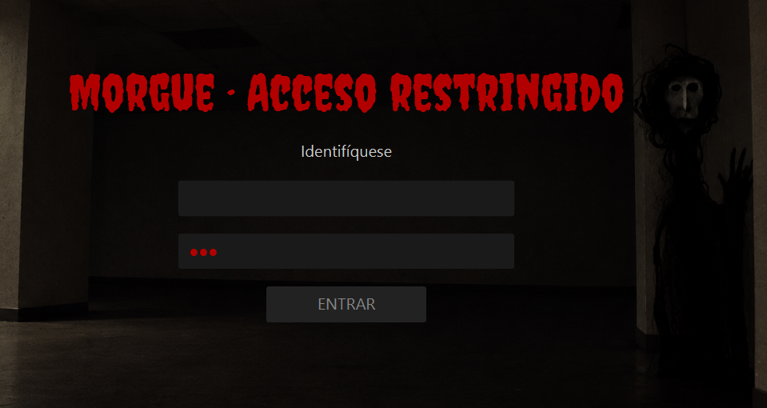
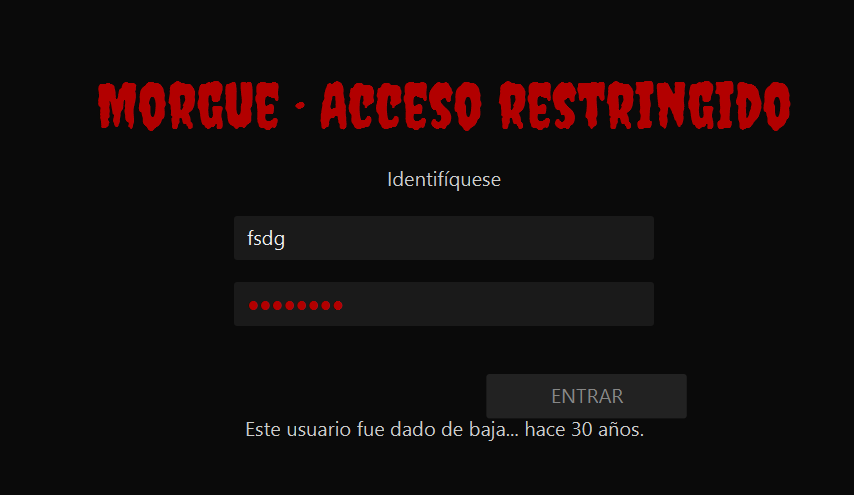
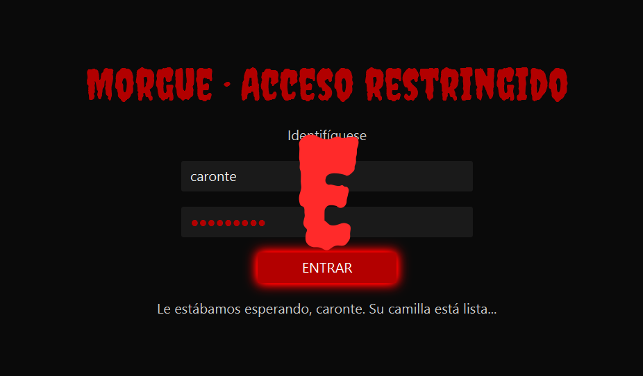

# Túnel del terror · Sala 3 · Login maldito

Aplicación JavaFX de la **Sala 3** del túnel del terror «El aula maldita» (Desarrollo de Interfaces, 2.º DAM, MEDAC).

**Autor:** grupo2

## La sala

El visitante llega a la pantalla de acceso de una morgue abandonada. La contraseña se escribe sola, como si alguien más estuviera usando el teclado, y el botón **ENTRAR** huye del ratón. Solo cuando escribe el **usuario maldito** que encontró en la página de «soporte técnico» de 1.º, el botón se queda quieto, se ilumina en rojo y, al pulsarlo, aparece la letra **E**.

- **Letra que entrega:** E
- **Si no lo resuelven en 60 segundos:** aparece una nota con las tres primeras letras del usuario.
- **Reinicio:** a los 12 segundos de mostrar la letra, la sala vuelve sola al estado inicial (o con **F12**).

## Pista acordada con 1.º

El usuario maldito es **`caronte`**, escondido en la página de «soporte técnico» del compañero de 1.º. No distingue mayúsculas de minúsculas.

## Cómo ejecutar

Requisitos: **JDK 21** y Maven (o el Maven Wrapper incluido).

```bash
mvn clean javafx:run
```

- La sala se abre a **pantalla completa** (Esc no sale, para evitar salidas accidentales).
- **F12:** reinicia la sala para el siguiente grupo.
- **Ctrl + Shift + Q:** cierra la aplicación.

## Capturas

| Inicio | Usuario incorrecto | Letra conseguida |
|---|---|---|
|  |  |  |

## Estructura

- `sala.fxml`: la vista (formulario de acceso, letra y ayuda).
- `SalaController.java`: la lógica (botón que huye, contraseña fantasma, validación, ayuda a los 60 s y reinicio).
- `estilos.css`: tema oscuro, fuente Creepster y brillo rojo del botón.
- `App.java`: arranque, pantalla completa, fuente, constante `PROPIETARIO` y teclas F12 / Ctrl+Shift+Q.

## Créditos de recursos

- **risa.wav:** «Evil Laugh», de Dragon Studio (Pixabay, Pixabay Content License). Modificada (voz femenina, más larga y con eco).
- **ambiente.mp3, acierto.wav, fallo.wav:** generados por síntesis de audio para este proyecto. Uso libre.
- **Fuente Creepster:** Sideshow (Google Fonts), SIL Open Font License.

## Reflexión de usabilidad

### Qué principio rompemos a propósito

Rompemos el principio de **control y libertad del usuario**, una de las 10 heurísticas de usabilidad de Jakob Nielsen: el usuario debe sentir que es él quien manda en la interfaz.

En nuestra sala ocurre justo lo contrario:

- El **botón ENTRAR huye** cada vez que el ratón se acerca: el usuario intenta hacer algo y la interfaz no le deja.
- La **contraseña se escribe sola**, y el campo no deja escribir: hay algo en el sistema que actúa sin que el usuario lo controle.

### Por qué da miedo

Da miedo porque **perder el control** de algo que normalmente obedece (un formulario de login, algo que usamos a diario) provoca inquietud: parece que hay «alguien más» al otro lado. No usamos sustos bruscos ni destellos; el miedo viene de que la interfaz parece tener voluntad propia. La risa y los mensajes («Nadie entra sin identificarse») refuerzan la sensación de que alguien observa.

### Cómo se entiende en 5 segundos

Aunque la interfaz es «de pesadilla», el visitante entiende enseguida qué hacer: es un login con un único campo editable (**usuario**) y un único botón (**ENTRAR**). Cada pocos intentos aparece un mensaje que le indica que tiene que identificarse, y cuando escribe el usuario correcto el botón deja de huir y **se ilumina**, dando una respuesta visual clara de que va por buen camino. Además, si en 60 segundos no lo consigue, la sala muestra una ayuda, así que siempre se puede ganar.

### Cómo lo corregiríamos en una aplicación real

- El botón **estaría siempre quieto** y se podría pulsar con ratón o teclado (Enter).
- El campo de **contraseña lo rellenaría el usuario**, nunca el sistema.
- Si el usuario es incorrecto, se mostraría un **mensaje claro y útil** («Usuario o contraseña incorrectos») en lugar de mensajes que asusten, y opciones como «¿Has olvidado tu contraseña?».
- Se podría **salir de la pantalla completa** con Esc, como espera cualquier usuario.

### Seguridad

La sala no tiene destellos ni efectos estroboscópicos (fotosensibilidad): las animaciones son un desplazamiento del botón, un temblor suave del campo y la aparición de la letra con escala y fundido. El volumen del ambiente está al 40 %.
